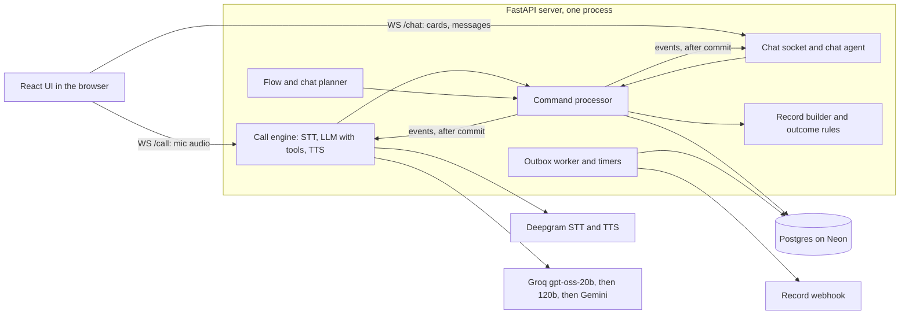

# voice-chat-agent

Ported to Python (FastAPI) from an earlier TypeScript prototype.

## 1. Overview

A customer reports a faulty device by **voice call** to an agent named Riya. Things that are awkward to say aloud (serial number or IMEI, purchase invoice, service centre, email) arrive as **cards in a chat** on the same page while the call continues. A message box in the chat is always available, so the customer can also just type. Voice and chat are two views of one session; every session ends in **one validated, versioned JSON record**, delivered to a webhook exactly once in effect.

**Live:** https://device-repair-agent.onrender.com/ (free hosting sleeps when idle, so the first load can take about a minute; use made-up data only). A start screen lists claims, with Resume, View and Delete (soft delete).

## 2. Architecture



- **One session, no per-channel state.** Every change is a command run by one processor under the session's row lock: state tables plus an append-only `events` row in one transaction, published to both sockets only after commit. A reload, a second tab or a restart replays the same conversation from Postgres.
- **Values are candidates.** An answer from the call or a card is appended as a candidate; the effective value of a field, and any conflict, is recomputed from them.
- **The call** is a cascaded pipeline on the server (Deepgram Nova-3 STT, the LLM with tools, Deepgram Aura-2 TTS); provider keys never reach the browser. On barge-in the server stops audio, aborts the model and truncates the transcript to what was heard.
- **Stack:** Python/FastAPI (required by the brief); a free-tier model (`gpt-oss-20b`) so spend stays $0; Postgres for state, files, timers and outbox, so one store is restored after a restart.

## 3. Conversation flow

1. The customer taps Call. Riya asks five questions by voice, in a fixed order: device type, model, problem, when it started, urgency.
2. The system, not the model, owns the order (`app/agent/flow.py`). After the voice questions it opens the chat cards one at a time (serial/IMEI, invoice, service centre, email), each at the start of the turn in which Riya announces it, so the card and her words arrive together. The model is told one `nextStep` per turn.
3. When everything required is in, the "Submit claim?" card opens and Riya reads the main details back. Only a tap on Yes submits; a spoken yes does not.
4. **Chat to voice:** a card answer commits, the event reaches the call engine, and Riya acknowledges it when idle. A message typed with no card open is treated by the call agent as something the customer said, and can be saved.
5. **Call to chat:** when the call ends (hang-up, drop, restart), the planner opens the next missing card in chat; typed messages are answered by a chat agent with the same prompt, tools and state. A returning call is told what was collected.

Identifiers must be typed: a serial number or email heard on the call is stored as `unverified` and never satisfies the field.

## 4. Final record and data integrity

Trimmed example (`shared/record.schema.json` is the full schema, checked on write and again by the receiver):

```json
{
  "schemaVersion": "1.0",
  "sessionId": "0b6f4c1e-3d2a-4e8b-9a71-5c2d8e9f1a3b",
  "revision": 2,
  "outcome": "completed",
  "outcomeReason": "all required fields valid; user confirmed submission",
  "previousRevision": { "revision": 1, "outcome": "partial" },
  "fields": {
    "deviceModel": { "value": { "brand": "Apple", "model": "iPhone 14 Pro" }, "source": "call", "collectedAt": "2026-11-10T10:00:40+05:30", "status": "valid" },
    "problemStartedAt": { "value": { "date": "2026-11-03", "precision": "day", "spoken": "last Tuesday" }, "source": "call", "collectedAt": "…", "status": "valid" },
    "serialNumber": { "value": { "kind": "imei", "value": "352099001761481" }, "source": "chat", "collectedAt": "…", "status": "valid" },
    "additionalPhotos": { "value": null, "source": "chat", "collectedAt": "…", "status": "skipped" }
  },
  "missingRequired": [],
  "conflicts": [{ "field": "email", "callValue": "asha.rao@example.com", "chatValue": "Asha.Rao@example.com", "resolution": "same", "reason": "values equal after normalization" }],
  "reviewFlags": [],
  "submitConfirmation": { "confirmed": true, "source": "chat", "at": "…" },
  "costUsd": 0.0123, "costBreakdownUsd": { "stt": 0.004, "llm": 0.0021, "tts": 0.0062, "vision": 0 }, "actualSpendUsd": 0
}
```

- **Validation and normalization** run server-side on every value (IMEI Luhn check, "last Tuesday" resolved in code against the session's date, brands canonicalised, select values checked against the server's list). A field is `valid`, `invalid`, `unverified`, `skipped` or missing (listed in `missingRequired`). `source` is `call` or `chat`, per field.
- **Grounding:** the model saves a value only with the customer's own words as evidence, checked against what they said.
- **Conflicts** (call and chat disagree) are resolved by policy and recorded: typed wins for identifiers, the call for narrative fields.
- **Outcomes:** `completed` (submitted, all required valid), `partial` (idle with something missing or unverified), `optedOut` (confirmed stop), `needsReview` (safety hazard flagged, unresolved identifier conflict, a field invalid after 3 attempts, or a record that fails its schema). Precedence: `optedOut` > `needsReview` > `completed` > `partial`.
- **Revisions and delivery:** a returning customer reopens the session; the next finalization writes revision n+1 only if the content hash changed, and earlier revisions are immutable (database triggers). The record, the status change and an `outbox` row commit in one transaction; a worker POSTs it with `Idempotency-Key: <session>:<revision>`, retrying with backoff, and the receiver stores a duplicate once.

## 5. Reliability and security

- **Restart recovery:** state, files, persisted timers (idle, expiry) and the outbox live in Postgres. At boot the server ends dangling calls (`server_restart`), re-arms timers, reclaims outbox leases and reconciles active sessions before listening. A restart ends a live call; the customer taps Call again and it resumes from saved state.
- **Interrupted sessions:** a dropped call hands over to chat, and a new call replaces a quiet one; 15 minutes idle finalizes the session.
- **Provider failure:** a rate-limited or failed model falls through to the next, then Gemini; an STT drop reconnects once; an exhausted quota refuses voice while chat keeps working.
- **Secrets** are read from the environment on the server only; CI runs gitleaks and scans the built web bundle for secrets.
- **Other controls:** Origin check on both sockets, size and rate limits, a concurrent-call cap, a daily quota guard, uploads checked by magic bytes (PDF, JPEG, PNG, WebP, up to 10 MB) and served only through signed, expiring links, user text passed to the model as tagged data, and strict security headers.
- **Caveat:** there are no accounts. A session id is a capability link, and the start screen lists and can soft-delete every claim on the server (a deliberate demo choice).

## 6. API

| Endpoint | Purpose |
|---|---|
| `GET /healthz`, `GET /readyz` | Liveness (no database) and readiness (checks the database) |
| `WS /chat?sessionId=` | Cards, messages, record; replays history on connect |
| `WS /call?sessionId=` | Binary PCM16 mic frames in, agent audio and transcript out |
| `POST /sessions/:id/files` | Upload an invoice or photo; returns an opaque file reference |
| `GET /api/sessions` | Claims for the start screen (title, status, progress) |
| `GET /api/sessions/:id` | Effective value and status of every field, open card, outcome |
| `GET /api/sessions/:id/timeline` | Events, transcript, per-turn timings, usage and cost, deliveries |
| `GET /api/sessions/:id/records` | Every revision, oldest first |
| `DELETE /api/sessions/:id` | Soft delete; refused while a call is on |
| `GET /files/:id?exp=&sig=` | Signed file link (only inside records) |
| `POST /hooks/records` | Stub receiver for record delivery (`X-Hook-Secret`, idempotent) |

A test-only API is registered only when `ALLOW_TEST_API=true`. Full details: [docs/api.md](docs/api.md).

## 7. Running locally

Needs Python 3.13 with [uv](https://docs.astral.sh/uv/), Node 22 (to build the UI) and a Postgres database (a free Neon one works).

```bash
uv sync
cp .env.example .env      # names only; fill in your own values
npm ci && npm run build -w web
set -a; . ./.env; set +a
uv run python -m app      # http://localhost:8080; migrations run at start
```

Required: `DATABASE_URL`, `PUBLIC_ORIGIN`, `FILE_URL_SECRET`, `HOOK_SECRET`. Voice also needs `DEEPGRAM_API_KEY` and `GROQ_API_KEY` (`GEMINI_API_KEY` is an optional fallback). Without provider keys the chat, cards, records and API still work; only calls are refused. Tests: `uv run pytest tests` (starts a throwaway Postgres 18, or set `TEST_DATABASE_URL`), `npm test` for the UI, `uv run ruff check app tests && uv run mypy app` for lint and types. Deployment is a Render Blueprint (`render.yaml`, Docker) that deploys only after CI passes.

## 8. Cost and performance

Every billable unit is a ledger row priced at the provider's published list price (`app/metrics/prices.py`); real spend is $0 on free tiers, so cost is a list-price equivalent. Latency is server-side, from Deepgram's end-of-utterance event to the first TTS audio frame, for every reply after a user utterance (nearest-rank percentiles). `scripts/report.py` computes both from the production database.

**Preliminary, measured (3 completed real sessions, 21 voice turns; the plan's gate is 10 sessions and 50 turns, so this is not final):**

| Measure | Result |
|---|---|
| Cost per completed session (list price) | mean $0.057 (Deepgram $0.051, Groq $0.006, Gemini <$0.001) |
| Server voice latency | p50 1,064 ms, p95 1,762 ms |
| Browser-side latency (noisy, secondary, n=17) | p50 2,241 ms, p95 5,525 ms |

TODO: re-run `scripts/report.py` after the remaining real sessions, with region, browsers and headphones.

## 9. Testing and limitations

About 1,170 Python tests and 90 UI tests. Scenario tests drive a real server through both sockets with fake providers: a card answered during a call, a call dropped then finished in chat, invalid answers (three attempts, then review), conflicting channels, reload and second tab, restart with a live call (crash injection), duplicate delivery, a `partial` resumed as revision 2, opt-out, forged uploads, provider failures. Guards taken from failing live sessions have regression tests.

**Known limitations**
- English only; one call at a time (free-tier model rate limit); the free server sleeps when idle.
- An identifier conflict is not asked about: it ends in `needsReview`.
- No browser end-to-end tests; sockets and a real server process are tested in Python.
- Barge-in stop latency is measured only from a spike (about 1.4 s from India against a 1.0 s budget), not on the deployed system.
- Some calls dropped while the customer chose a file; the likely cause (the file dialog pausing audio capture) is a mitigation, not confirmed.
- Single instance: rate limits and the call cap are in process memory.

**Least trusted: the model's behaviour on a real call.** Tool handling and guards are tested with scripted models, but a free-tier 20B model's choices and wording are only checked by hand, and only a few real sessions have exercised the current flow.

## 10. Decisions and next steps

| Decision | Reason |
|---|---|
| The system owns the order; the model owns the words | Left to the model, cards appeared out of step with speech and answers landed in the wrong fields |
| Typed identifiers; explicit "Submit" tap | Speech recognition is unreliable for alphanumerics; a misheard yes must not submit |
| Dates resolved in code | Models get date arithmetic wrong |
| Append-only events and revisions | A full audit trail, and a duplicate can never overwrite a delivered record |

**With another week:** run the 10 measured sessions and measure barge-in on the deployed server; add a "which is correct?" card for identifier conflicts; Hindi; browser end-to-end tests; accounts, so the claim list is per user.

**AI tools:** Claude Code wrote most of the code and tests under my direction. It misled me in ways live sessions exposed: a tool-description example value ("Apple iPhone 14 Pro") that the model copied as a real answer, a planner that opened chat cards ahead of the voice, and a microphone-silence check that hung up during file selection.

More detail in [docs/](docs/): architecture, record and outcomes, reliability, security, performance, decisions.
