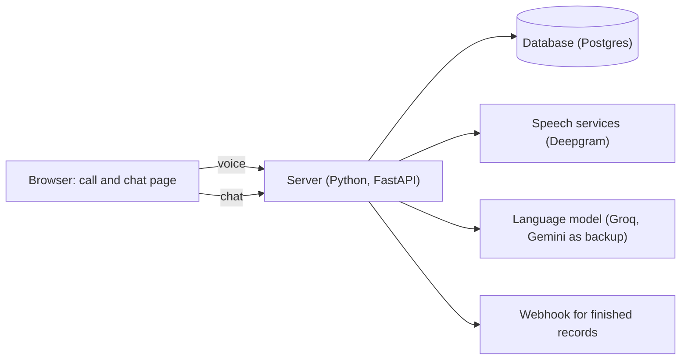

# Riya: a voice and chat assistant for device repair claims

Ported to Python (FastAPI) from an earlier TypeScript prototype.

**Live demo:** https://device-repair-agent.onrender.com/ (free hosting sleeps when idle, so the first load can take about a minute; please use made-up data).

## What it is

A customer wants to register a repair for a broken phone or laptop. Instead of filling in a form, they **talk to an assistant called Riya**. Things that are hard to say out loud (a serial number, an invoice, an email address) show up as **small cards in a chat next to the call**, and the customer can also just type a message at any time. When they confirm, the app produces **one clean, checked record** of the claim and sends it on to a webhook.

The call and the chat are not two separate systems. They are two ways of talking to the same conversation, so nothing has to be said twice.

## A walk through one claim

1. The customer opens the page and taps the phone button. Riya greets them and asks five simple questions by voice: what kind of device, which model, what's wrong, when it started, how urgent it is. They can interrupt her at any time.
2. When the voice questions are done, Riya says "I've sent you a box for your serial number", and **at that moment** a card appears in the chat. The customer types the number; Riya says "Got it" and moves on to the invoice (a file upload), the service centre (a pick list) and an email address. One card at a time, always in step with what she says.
3. At the end Riya reads the main details back, and a "Submit claim?" card shows the full summary. The claim is only submitted when the customer taps **Yes**.
4. If the call drops, the page tries to reconnect by itself, and if it can't, the chat simply carries on from exactly where things were. The customer can come back to the same claim later from the start screen.
5. The result is one structured record, checked against a schema and delivered to a webhook exactly once.

## How it is built



- **One conversation, two doors.** Voice and chat both go through the same server and write to the same database. Every change is saved as a small event that both the call and the chat are told about. So when the customer submits a card in the chat, Riya hears about it within a moment and acknowledges it; when they type a message, she treats it like something they said.
- **The server owns the order, the AI owns the words.** The server decides what happens next (voice questions first, then one card at a time, then the summary). The language model only decides how to say it. This is what keeps the cards and Riya's speech in step.
- **The AI must quote the customer.** Riya can only write a value into the claim if she quotes the customer's own words, and the server checks that quote. Dates like "last Tuesday" are worked out by code, not by the model. A serial number or email must be typed, never just heard.
- **Nothing lives only in memory.** Everything (conversation, files, timers, the delivery queue) is in the database, so a restart loses nothing.

Why these choices: Python/FastAPI because the assignment asks for it; free-tier services (Deepgram, Groq `gpt-oss-20b`, Neon, Render) so the real spend is $0; and one database for everything so there is one place to recover from.

## The final record

Every session ends in one JSON record. A shortened example:

```json
{
  "sessionId": "0b6f4c1e-3d2a-4e8b-9a71-5c2d8e9f1a3b",
  "revision": 1,
  "outcome": "completed",
  "fields": {
    "deviceModel": { "value": { "brand": "Apple", "model": "iPhone 14" }, "source": "call", "status": "valid" },
    "serialNumber": { "value": { "kind": "imei", "value": "352099001761481" }, "source": "chat", "status": "valid" },
    "additionalNotes": { "value": null, "source": "chat", "status": "skipped" }
  },
  "missingRequired": [],
  "conflicts": [],
  "reviewFlags": [],
  "costUsd": 0.057
}
```

(The full schema is `shared/record.schema.json`; the record is validated against it before it is saved.)

- **Checked and cleaned:** an IMEI must pass its checksum, brands are tidied ("IPhone" becomes "iPhone"), service centres must come from the server's list, files must be real PDFs or images.
- **Every field says where it came from** (`call` or `chat`) and its status: valid, invalid, skipped, unverified (heard but not typed) or missing. If the call and the chat disagree, a simple rule decides and the disagreement is recorded.
- **Four possible endings:**

| Outcome | Meaning |
|---|---|
| `completed` | The customer confirmed and everything required is valid |
| `partial` | The customer left with something still missing (the claim can be resumed) |
| `optedOut` | The customer asked to stop and confirmed |
| `needsReview` | A person should look: a safety problem was mentioned (swollen battery, smoke), a field kept failing, or the details conflict |

- **Coming back later** creates a new revision (revision 2, and so on) only if something changed; older revisions never change.
- **Delivered once:** the record and its "to be sent" entry are saved together. A worker sends it with a unique key per session and revision, so a retry can never create a duplicate on the receiving side.

## When things go wrong

- **The call drops:** the page redials automatically (keeping the microphone open), and the server replaces the dead call. If it can't reconnect, the chat takes over.
- **The server restarts:** a live call ends, but the claim, the open card and the timers are all in the database and come back. Tapping Call resumes where it left off.
- **The AI service is busy or down:** the app falls back to a second model, then to Gemini. If speech or the free quota fails, voice is politely declined and the chat keeps working.
- **The customer goes quiet:** silence is not counted while they are busy with a chat card (for example choosing a file).

## Security in brief

Provider keys stay on the server, never in the browser or the repository (CI scans for leaked secrets). Both WebSockets check the page's origin. Uploads are checked by their real file type and size, and are only served through signed, expiring links. There are rate limits, a cap on concurrent calls and a daily quota guard. **One honest caveat:** there are no accounts. A session id works like a private link, and the start screen lists and can delete every claim on the server. That is a deliberate shortcut for the demo.

## API

| Endpoint | What it does |
|---|---|
| `WS /call`, `WS /chat` | The voice call (audio in, audio and transcript out) and the chat (cards, messages, record) |
| `POST /sessions/:id/files` | Upload an invoice or photo |
| `GET /api/sessions` | The list of claims for the start screen |
| `GET /api/sessions/:id` | A claim's current fields, open card and outcome |
| `GET /api/sessions/:id/timeline` | Everything that happened, with timings and cost |
| `GET /api/sessions/:id/records` | Every revision of the final record |
| `DELETE /api/sessions/:id` | Hide a claim from the list (soft delete) |
| `POST /hooks/records` | A built-in receiver for the delivered record |
| `GET /healthz`, `GET /readyz` | Health checks |

More detail, including errors: [docs/api.md](docs/api.md).

## Run it yourself

You need Python 3.13 with [uv](https://docs.astral.sh/uv/), Node 22 (to build the page) and a Postgres database (a free Neon one works).

```bash
uv sync
cp .env.example .env      # names only; fill in your own values
npm ci && npm run build -w web
set -a; . ./.env; set +a
uv run python -m app      # http://localhost:8080 (the database is set up automatically)
```

The settings you must fill in are `DATABASE_URL`, `PUBLIC_ORIGIN`, `FILE_URL_SECRET` and `HOOK_SECRET`; for voice also `DEEPGRAM_API_KEY` and `GROQ_API_KEY` (`GEMINI_API_KEY` is an optional backup). Without the provider keys, chat, cards, records and the API still work. Tests: `uv run pytest tests` (needs a local Postgres or `TEST_DATABASE_URL`), `npm test` for the page. The project is deployed on Render from `render.yaml`, after the checks in CI pass.

## Cost and speed

Cost is the **list price** of what was used (speech, language model), counted per session from a usage ledger; real spend is $0 because everything runs on free tiers. Speed is measured on the server, from the moment Deepgram says the customer stopped talking to the first audio frame of Riya's answer. Both come from `scripts/report.py`, which reads the real database.

**Preliminary (3 finished real sessions, 21 spoken turns; the plan calls for 10 sessions and 50 turns, so this is not final):**

| | Result |
|---|---|
| Cost per completed session | about $0.057 (speech $0.051, language model $0.006) |
| Time to Riya's first audio | median 1.06 s, 95th percentile 1.76 s |

*TODO: re-run `scripts/report.py` after the remaining real sessions and update these numbers.*

## Tests and honest limitations

About 1,170 Python tests and 101 page tests. Many are scenario tests that run a real server with fake providers: a card answered during a call, a dropped call finished in chat, repeated invalid answers, call and chat disagreeing, a reload, a restart in the middle of a call, duplicate delivery, a returning customer, uploads of fake files. Several guards exist because a real call failed in exactly that way.

Known limitations:
- English only; one call at a time (the free model's rate limit); the free server sleeps when idle.
- If the call and chat disagree about an email or serial number, it goes to review instead of asking the customer.
- No browser end-to-end tests. The automatic call redial is tested only as logic, not yet in a real browser.
- Barge-in (interrupting Riya) is built and tested, but its speed has only been measured in an early experiment (about 1.4 s from India), not on the deployed app.
- Single server instance: some limits are kept in memory.

**What I trust least:** how the free-tier language model behaves on a real call. The guards around it are tested with scripted models, but its choices and wording are only checked by hand, and only a few real calls have used the current flow.

## Decisions, and what's next

The main decisions: the server decides the order (the model only speaks); identifiers must be typed; submitting needs an explicit tap; everything is kept as history rather than overwritten.

With another week: run the ten measured sessions and measure interruption speed on the deployed app; ask the customer to settle conflicting identifiers; add Hindi; browser end-to-end tests; real accounts, so each person sees only their own claims.

**AI tools:** Claude Code wrote most of the code and tests under my direction. It misled me in ways real calls exposed: an example value in a tool description ("Apple iPhone 14 Pro") that the model copied as a real answer, a planner that opened chat cards ahead of Riya's speech, and a microphone check that hung up while the customer was choosing a file.

More detail in [docs/](docs/): architecture, record and outcomes, reliability, security, performance, decisions.
